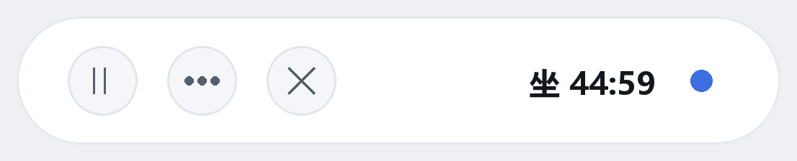
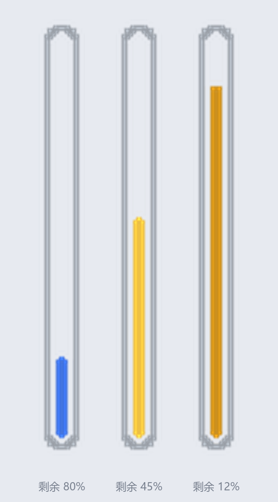
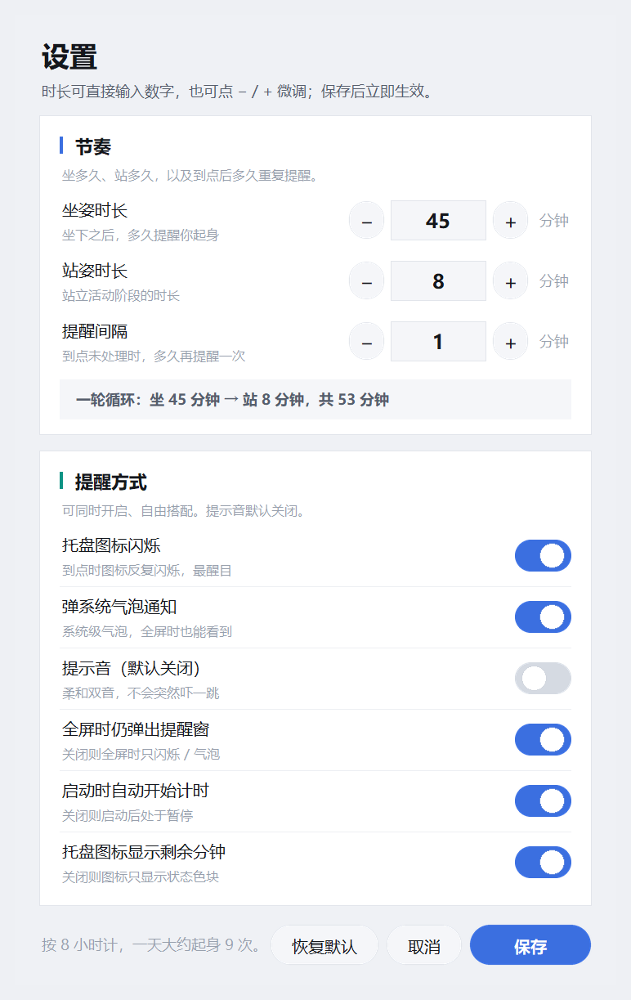

# 久坐提醒

[](LICENSE)
[](#)
[](#)

一款轻量的久坐提醒工具。按固定节奏循环，帮助你在工作间隙自然地起身活动，而不是一坐就是一整段：

```
坐下工作  →  到点提醒  →  站立活动  →  回到坐下  →  循环
         （默认 45 分钟）    （默认 8 分钟）
```

三个时长均可调整。设计取向可以概括为一句话：**免安装、离线、启动快；默认静音、默认不遮挡；到点一定提醒到你，且操作入口当场就在眼前。**

<p align="center">
  
</p>

<p align="center">
  <sub><b>悬浮细条 · 展开态</b>：状态点 + 精确倒计时 + 进度条 + 快捷操作按钮</sub>
</p>

<br>

<p align="center">
  
</p>

<p align="center">
  <sub><b>悬浮细条 · 收起态</b>：默认贴靠屏幕边缘，外形是一根「试管」——灰色管壁、中间透空，内部按剩余进度自下而上填充；剩余不足一半起由状态色转为黄色并逐渐加深，接近到点时过渡到珊瑚红（三种剩余时间对照示意）</sub>
</p>

<br>

<p align="center">
  
</p>

<p align="center">
  <sub><b>提醒窗</b>：到点自动出现，三个按钮可直接处理，无需再去找入口</sub>
</p>

---

## 目录

- [特性](#特性)
- [下载与运行](#下载与运行)
- [三种显示形态](#三种显示形态)
- [提醒方式](#提醒方式)
- [设置项](#设置项)
- [目录结构](#目录结构)
- [从源码构建](#从源码构建)
- [常见问题](#常见问题)
- [技术说明](#技术说明)
- [English](#english)
- [License](#license)

---

## 特性

- **双击即用**：免安装、离线运行、不写注册表、不联网；冷启动实测约 **0.5 秒**。
- **可整体拷走**：把整个程序文件夹拷到任意 64 位 Windows（Win10 / 11）上直接运行，无需安装 Python。
- **平时完全无感**：默认不显示任何窗口，仅在系统托盘常驻一个小图标。
- **到点必提醒**：图标闪烁 + 系统气泡 + 自动弹出可操作的提醒窗，三路同时触发；未处理则按间隔重复提醒。
- **入口当场可用**：提醒窗内直接提供「我已站起 / 稍后 / 跳过」按钮，无需事后再去找设置或菜单。
- **默认静音**：提示音默认关闭，需要时可在设置中单独开启（柔和双音，不刺耳）。
- **边缘吸附式悬浮条**：可选开启。贴靠屏幕边缘收起为一根「试管」——灰色管壁、中间透空、内部自下而上填充；剩余不足一半转为黄色并逐渐加深，接近到点时过渡到珊瑚红，扫一眼即可掌握当前阶段与剩余时间。
- **高 DPI 友好**：按屏幕缩放比例等比渲染，高分屏下文字锐利、边缘平滑。

---

## 下载与运行

### 方式一：便携版（推荐，无需安装 Python）

1. 到本仓库的 [**Releases**](../../releases) 页面下载最新的 `SitStandReminder-portable.zip`。
2. **解压整个文件夹**（不要只解压出 exe）。
3. 双击 `SitStandReminder.exe` 即可，启动后自动开始计时。

> [!WARNING]
> `SitStandReminder.exe` 必须与同目录的 `_internal` 文件夹放在一起，缺一不可。请**整个文件夹一起拷贝**，不要只拖走那个 exe。

### 方式二：源码版（适合想修改代码的用户）

需要本机已安装 **Python 3.8+**，并安装依赖：

```bash
pip install Pillow pywin32 pystray
```

然后在 `src/` 目录下：

- 双击 **`Start.bat`**：无控制台窗口启动；
- 双击 **`Debug.bat`**：带控制台启动，**能看到报错和实时日志**，排查问题时使用这个。

> [!TIP]
> `Start.bat` / `Debug.bat` 会按顺序自动寻找解释器：脚本同目录的 `pythonw_path.txt` / `python_path.txt` → 同目录的 `.venv` → python.org 安装器的默认位置 → `PATH`。
>
> 如需固定使用某个解释器，可在同目录创建 `pythonw_path.txt`，写入 `pythonw.exe` 的完整路径。

---

## 三种显示形态

### 1. 托盘图标（常驻、最小）

- 图标上的**数字 = 当前阶段剩余分钟数**。
- **左键单击**：开始 / 暂停计时。
- **鼠标悬停**：气泡显示当前状态 + 剩余时间。
- **右键单击**：完整菜单（立即暂停 / 继续、立刻起身 / 坐下、重新开始本轮、显示 / 隐藏悬浮细条、设置、使用说明、退出）。

### 2. 悬浮细条（可选，**默认不显示**）

在托盘菜单中选「显示悬浮细条」后出现，默认贴靠屏幕边缘收起。悬浮条的设计参考了主流即时通讯软件的系统托盘贴边交互：平时让位、需要时即时展开。

**收起态（默认）** — 停在屏幕左 / 右边缘内侧，是一根约 **11×100 设计像素**的「试管」：一圈**浅灰色管壁**、中间透空（直接露出桌面），内部一根两端圆角的小液柱自下而上增长，与管壁四周留出均匀缝隙（左右各 3 设备像素、上下各 2 设备像素），填充比例等于剩余时间百分比。液柱颜色分三段：剩余超过一半时用当前状态色，过半后转为黄色并逐渐加深，接近到点时过渡到珊瑚红。

> [!NOTE]
> 试管是**离屏超采样绘制 + 颜色硬化**的：先在 8 倍尺寸下画好再缩回，然后把抗锯齿产生的半透明过渡像素与混色全部收拢回「管壁灰 / 液柱色」两种纯色。否则在 16 设备像素这个尺度下，管壁会渲染出十几种色阶，看起来又糊又脏。

**展开态** — 鼠标移上去自动弹出，显示状态圆点 + `坐 32:15` 精确读数 + 进度条 + 三个小按钮（暂停 / 继续、菜单、关闭）。

- **严格 1:1 跟手拖动**：鼠标移动多少，条就移动多少（实测误差 0 px）。
- **边缘吸附**：拖到屏幕左 / 右边缘附近松手，自动吸附并收起。
- **中途松手**：不停在边缘则停在当前位置，约 2 秒后自动收起。
- **不占用桌面空间**：默认根本不会显示，因此不存在遮挡问题。

### 3. 提醒窗（到点时自动出现）

到点自动弹出的小窗口，默认位于屏幕右下角，尺寸约 **356×150 设计像素**（紧凑，接近一条通知而非一个对话框），可拖动、可关闭（关闭等同于稍后）。

- 内容：状态色点 + 标题（如「该站起来了」）+ 一行说明 + 三个按钮。
- 按钮：`我已站起 / 我已坐下`（主操作，实心色）、`稍后 N 分钟`、`跳过`。
- 拖动位置会被记住，下次提醒仍在同一位置。

---

## 提醒方式

到点时以下方式**同时**触发，均可在设置中单独开关：

| 方式 | 默认 | 说明 |
|---|---|---|
| 托盘图标闪烁 | 开 | 到点时图标反复闪烁，最直观 |
| 图标显示剩余分钟 | 开 | 平时即可一眼看到还剩多久 |
| 弹系统气泡通知 | 开 | 系统级气泡，全屏时也能看到 |
| 自动弹出提醒窗 | 开 | **可操作入口**，直接点按钮处理 |
| 提示音 | **关** | 需要时单独开启（柔和双音，不刺耳） |

> [!NOTE]
> 「提醒间隔」控制重复提醒：到点后若一直不处理，每隔这么久**再提醒一次**（默认 1 分钟），直到处理为止。

---

## 设置项

托盘右键 →「设置…」。修改后点 `保存` **立即生效**，并写入同目录的 `settings.json`。

<p align="center">
  
</p>

**时长（3 项）**

三个时长均支持**直接输入数字**（点一下输入框即可键入），同时保留 `−` / `+` 按钮微调：

| 设置 | 默认 | 范围 | 含义 |
|---|---|---|---|
| 坐姿时长（分钟） | 45 | 1–600 | 坐下后、提醒前的时长 |
| 站姿时长（分钟） | 8 | 1–600 | 站立活动阶段的时长 |
| 提醒间隔（分钟） | 1 | 1–120 | 到点未处理时，重复提醒的间隔 |

> [!TIP]
> 输入框支持键盘直接输入、回车确认、`Esc` 撤销、上下方向键微调、鼠标滚轮微调；输入非法值或超出范围会自动夹到合法值。

**开关（6 项）**

| 设置 | 默认 | 含义 |
|---|---|---|
| 托盘图标闪烁 | 开 | 到点时图标闪烁 |
| 弹系统气泡通知 | 开 | 到点时弹气泡 |
| 提示音 | **关** | 到点时播放柔和提示音 |
| 全屏时仍弹出提醒窗 | 开 | 关闭则全屏时不弹窗，仅闪烁 / 气泡 / 声音 |
| 启动时自动开始计时 | 开 | 关闭则启动后处于暂停，需手动开始 |
| 托盘图标显示剩余分钟 | 开 | 关闭则图标只显示状态色块 |

### 配色约定

三种状态各对应一个主色，**由单一常量驱动全链路**（悬浮条填充 / 卡片进度条 / 状态点 / 托盘图标 / 提醒窗状态点）：

| 状态 | 颜色 | 常量 |
|---|---|---|
| 坐姿 | 蓝 `#3B6FE0` | `C_SIT` |
| 站姿 | 青碧 `#0E9384` | `C_STAND` |
| 到点提醒 | 柔珊瑚 `#DE6B62` | `C_ALERT` |

收起态细条的液柱颜色按剩余进度**三段过渡**：

| 剩余进度 | 液柱颜色 |
|---|---|
| 超过一半 | 当前状态色（坐姿蓝 / 站姿青碧） |
| 一半 → 一成（渐深） | 亮黄 `#F2C744` → 琥珀 `#C98A16` |
| 一成 → 到点 | 琥珀 → 柔珊瑚 `#DE6B62` |

> [!IMPORTANT]
> 同色系的深 / 浅档一律由主色**现算**（`darken()` / `mix()`），不得硬编码。否则更换主色时会出现「新主色 + 旧深色」的割裂。自检脚本中有专门的断言锁定这一点。

---

## 目录结构

```
SitStandReminder/
├── src/                        ← 源码
│   ├── sitstand.py             ← 主程序（唯一程序文件）
│   ├── Start.bat               ← 一键启动（无控制台）
│   ├── Debug.bat               ← 调试启动（有控制台，能看到报错）
│   ├── SitStandReminder.spec   ← PyInstaller 打包配置
│   ├── app.ico                 ← 图标
│   ├── soft_chime.wav          ← 提示音
│   ├── _smoke.py               ← 自检套件（71 项）
│   └── _make_previews.py       ← 离屏生成 README 用的预览图（零打扰）
├── previews/                   ← 界面截图
│   ├── strip-expanded.png
│   ├── strip-collapsed.png
│   ├── settings.png
│   ├── alert.png
│   └── help.png
├── .gitignore
├── LICENSE
└── README.md
```

> [!NOTE]
> 便携版（`dist/`）**不在仓库中**，请从 [Releases](../../releases) 下载——约 25 MB 的二进制文件放进去会让仓库历史永久变大。

---

## 从源码构建

```bash
pip install pyinstaller Pillow pywin32 pystray
cd src
pyinstaller --noconfirm SitStandReminder.spec
```

产物在 `src/dist/SitStandReminder/`。整个文件夹即便携版，可直接拷走。

> [!TIP]
> 采用 **onedir（文件夹）而非单文件 exe**：单文件 exe 每次启动都要把运行时解压到临时目录，通常需要 3–5 秒；onedir 直接加载，实测约 0.5 秒。此外 onedir 且**不加 UPX 压缩、不注入进程、不写注册表、不联网**，被安全软件误报的概率也远低于单文件 exe。

---

## 常见问题

- **启动没反应？** 查看 exe 同目录的 `app.log`；源码版用 `Debug.bat` 可实时看到输出。
- **拷到别的电脑后打不开？** 确认 `SitStandReminder.exe` 与 `_internal` 文件夹在一起（需拷贝整个文件夹）。
- **提示「已经在运行」？** 说明已有一个实例在托盘中，查看右下角图标即可，无需重复启动。
- **提醒窗挡住视频？** 处理或点 `稍后` 后会自动消失；也可在设置中关闭「全屏时仍弹出提醒窗」。
- **如何彻底退出？** 托盘右键 →「退出」。
- **换机器后 `Start.bat` 找不到 Python？** 把 `pythonw.exe` 的完整路径写进 `src\pythonw_path.txt`。
- **想改界面 / 改功能？** 直接编辑 `src/sitstand.py`；改完可用 `SitStandReminder.spec` 重新打包。

---

## 技术说明

- **技术栈**：Python 3 + tkinter（界面）+ pystray / pywin32（系统托盘）+ Pillow（动态图标与抗锯齿圆角绘制）。
- **无边框窗口**：窗口使用 `overrideredirect(True)` 去除系统边框，再配合 `-transparentcolor` 抠掉圆角外的背景，得到干净的圆角卡片。为避免抗锯齿边缘出现灰黑描边，所有圆角图像都会先按 alpha 二值化「拍平」到图形本色上。
- **不占任务栏**：悬浮条与提醒窗只添加 `WS_EX_TOOLWINDOW`，不会在任务栏单独占一格，也不进 Alt+Tab。
- **拖动 1:1**：拖动时用 `win32api.GetCursorPos()` 取**物理像素**鼠标位置，按 `新位置 = 旧位置 + 鼠标位移` 计算。不使用 Tk 的 `e.x/e.y`——那是逻辑像素，与 `geometry()` 要求的物理像素在高 DPI 下相差一个倍率，且窗口自身移动会污染参照系。
- **计时不会卡死**：主循环与命令轮询都包了 `try`，并把 `after()` 的重排放在 `finally` 中；窗口对象通过 `winfo_exists()` 真判活，失效则自动重建。
- **单实例运行**：使用命名互斥体保护，重复双击不会启动第二个实例，而是提示查看托盘图标。
- **状态全部本地**：设置与日志都写在程序同目录，便于备份和迁移，不写注册表。

---

## English

**Sit / Stand Reminder** — a lightweight sedentary-work reminder for Windows. Designed around a sit / stand desk workflow, but it works for any desk.

It cycles through *sit → remind → stand & move → sit again*, defaulting to 45 minutes sitting and 8 minutes standing (all three durations are adjustable).

**Highlights**

- **Zero-install and offline.** Distributed as a portable folder; no Python required, no registry writes, no network access. Cold start takes about 0.5 s.
- **Never in the way.** Nothing is shown by default except a small tray icon.
- **Reminders you cannot miss.** The tray icon flashes, a balloon notification appears, and an actionable reminder window pops up — all at once. If ignored, it re-reminds on a fixed interval until handled.
- **Actionable at the moment of reminder.** The reminder window carries its own *I've stood up / Snooze / Skip* buttons, so there is no need to hunt for an entry point afterwards.
- **Silent by default.** The chime stays off unless you turn it on.
- **Optional edge-snapping strip.** A thin rounded strip that docks to the screen edge and fills with the state colour to indicate remaining time. Dragging tracks the mouse at a strict 1:1 ratio.
- **High-DPI aware.** Everything scales with the display's DPI.

**Run it**

1. Download `SitStandReminder-portable.zip` from [Releases](../../releases).
2. Extract the **whole folder** and double-click `SitStandReminder.exe`.

**Build from source**

```bash
pip install pyinstaller Pillow pywin32 pystray
cd src
pyinstaller --noconfirm SitStandReminder.spec
```

The output lands in `src/dist/SitStandReminder/`.

> [!WARNING]
> The `.exe` must stay next to the `_internal` folder — that is why the whole directory has to be copied, not just the executable.

---

## License

[MIT](LICENSE)
